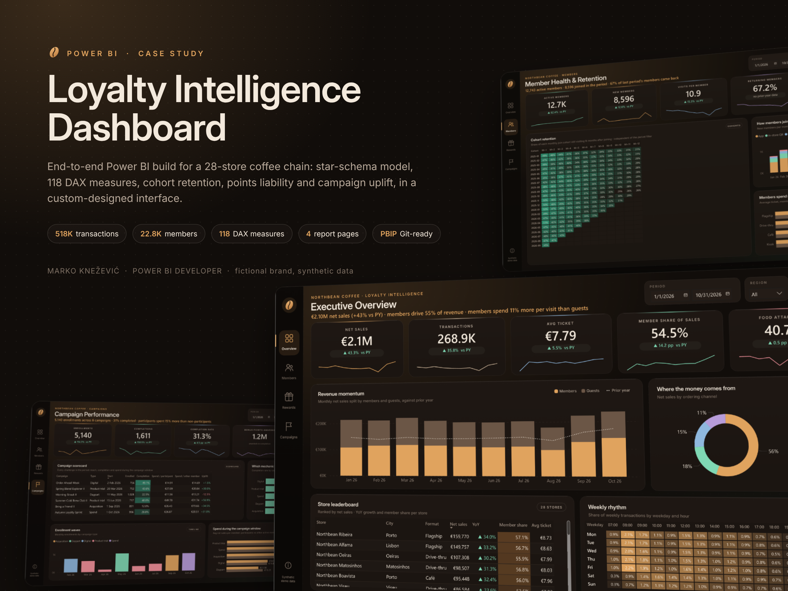
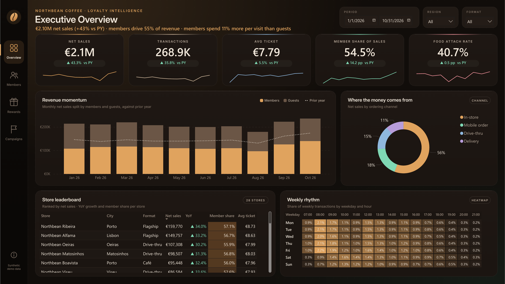
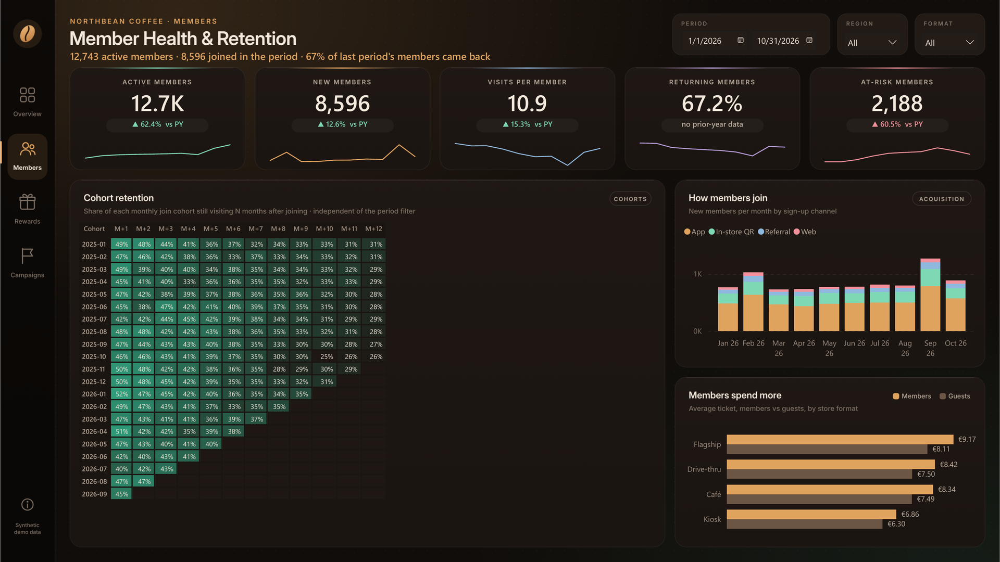
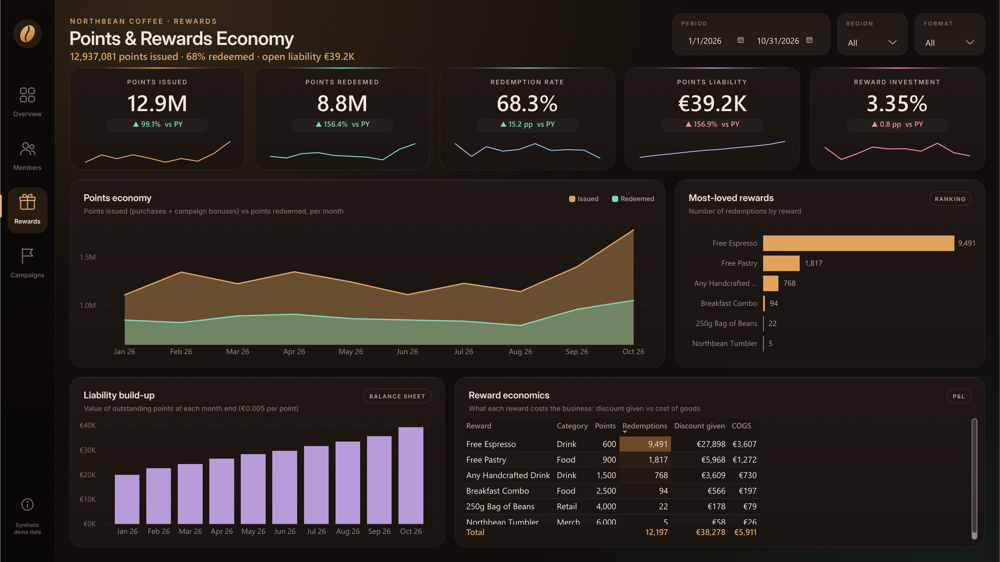

# Northbean Coffee: Loyalty Intelligence Dashboard (Power BI)

This is an end-to-end Power BI portfolio project. It covers loyalty analytics for **Northbean Coffee**, a fictional 28-store coffee chain in Portugal. Every number in it is **synthetic**: Python generates the data with realistic seasonality, member behaviour, churn, point redemptions and campaign mechanics.

The project is saved as a **PBIP** (Power BI Project). The model is stored as TMDL and the report as PBIR, so every measure, relationship and visual is a readable text file, ready for Git.

## What the report answers

| Page | Business question | Highlights |
|---|---|---|
| **Executive Overview** | Is the business growing, and how much of the growth comes from members? | KPI tiles with YoY deltas and sparklines, members vs guests vs prior year, channel mix, a store leaderboard, and a weekday × hour traffic heatmap |
| **Member Health & Retention** | Are we acquiring members and keeping them? | Active / new / returning / at-risk members, a monthly **cohort retention triangle**, acquisition channels, and member vs guest ticket size |
| **Points & Rewards Economy** | What does the programme cost, and how big is the liability? | Points issued vs redeemed, redemption rate, **outstanding points liability (€)**, reward ranking and reward P&L |
| **Campaign Performance** | Which challenges work? | Enrollment, completion and **spend uplift of participants vs non-participants** for each campaign and mechanic |

Each page also has a **headline sentence written by DAX** that summarises the current filter selection.

## Screenshots

| | |
|---|---|
|  |  |
|  |  |

## Data model

- **Facts:** `Transactions` (518K rows), `Redemptions` (19K), `Campaign Enrollments` (8K)
- **Dimensions:** `Calendar` (a DAX date table, marked as the date table), `Stores`, `Members`, `Rewards`, `Campaigns`
- **Disconnected axis:** `Cohort Offset` (M+1 … M+12), used by the cohort matrix
- **Inactive relationship:** `Campaign Enrollments[CompletedDate]`, activated with `USERELATIONSHIP` for bonus points; new members by join date use `TREATAS`
- **No implicit measures.** All 118 measures sit in one `_Measures` table, organised into display folders:
  - **Sales:** net sales, ticket, member share, food attach rate, traffic share
  - **Members:** active members, new members, returning % (vs the previous period of the same length), at-risk members (last visit 45–120 days ago), cohort retention
  - **Rewards:** points issued (purchases + campaign bonuses), redeemed, redemption rate, running liability, reward investment %
  - **Campaigns:** completion rate, plus spend per participant vs other active members during each campaign window
  - **KPI Cards:** a prior-year value, a delta, a ▲▼ label and a good/bad colour for every KPI (generated consistently)

## Design

A dark, coffee-inspired interface built for quick reading. Each page uses a custom background with a sidebar menu and card layout, and a custom theme (`NorthbeanEspresso.json`) keeps colours and fonts consistent across all visuals. The sidebar works as page navigation, and the period, region and format filters stay in sync as you move between pages. Every KPI tile shows the value, the change vs last year in green or red, and a monthly trend line.

## How to open

1. Unzip the project to `C:\Northbean\`, so the CSV files end up in `C:\Northbean\data\`.
   If you use a different folder, open **Transform data → Edit parameters** and change `DataFolder` (keep the trailing backslash).
2. Open `Northbean.pbip` in Power BI Desktop. Older Desktop versions need the PBIP / PBIR preview features enabled.
3. Click **Refresh**. A PBIP does not store data, so the visuals stay empty until the first refresh.

To regenerate the data, run `python scripts/generate_data.py data`. It needs `numpy` and `pandas`, and the seed is fixed so the output is reproducible.

---
Built by **Marko Knežević** · Northbean Coffee is a fictional brand.
